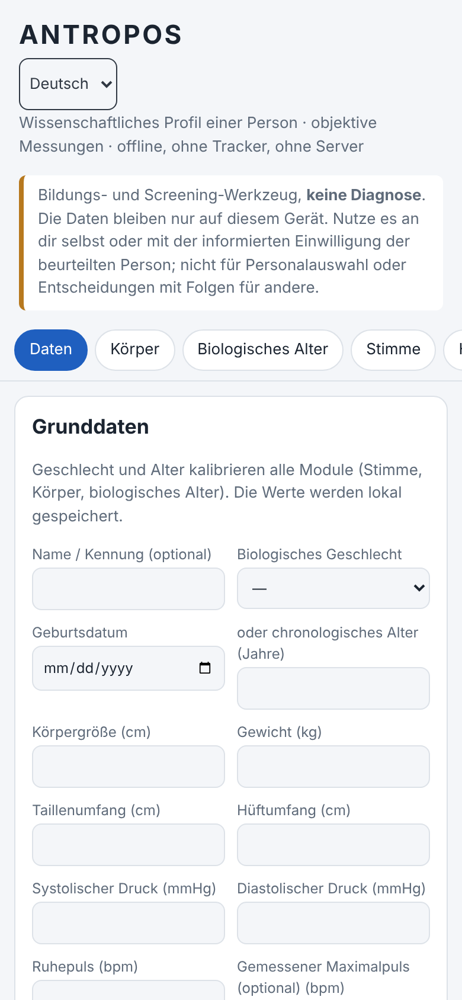
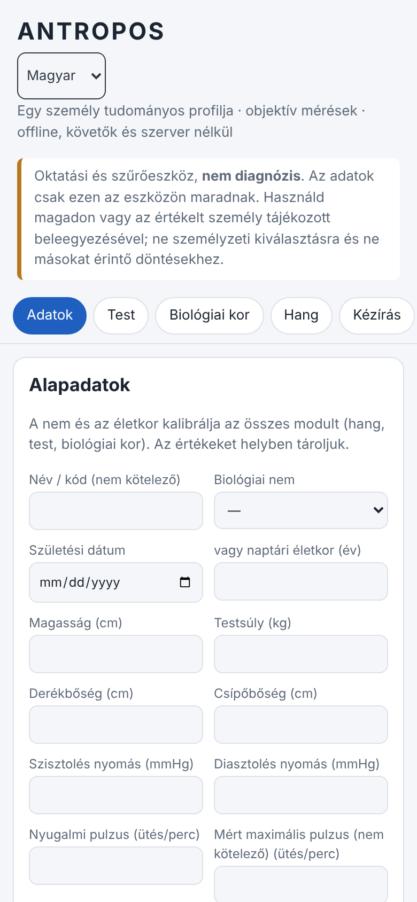

# ANTROPOS

[English](README.md) · [Română](README.ro.md) · [Français](README.fr.md) · [Italiano](README.it.md) · [Español](README.es.md) · [Português](README.pt.md) · **Deutsch** · [Magyar](README.hu.md)

Orientierendes wissenschaftliches Profil einer Person, lokal berechnet: biologisches Alter (PhenoAge), Stimme, Handschrift, Uhrentest, Persönlichkeit (TIPI) und Reaktionszeit.

**[App öffnen →](https://antropos.chiuta.ro/)**

_Version: 1.2.2 · Letzte Aktualisierung: 2026-11-17_

| 1 | 2 | 3 |
|---|---|---|
|  |  |  |

## Screenshots

       

## Funktionen

- Biologisches Alter nach PhenoAge, mit Plausibilitätsprüfung für unwahrscheinliche Laborwerte.
- Stimmanalyse mit Oktavsprung-Filter, Graphometrie, Uhren- und Mensch-zeichnen-Test.
- TIPI-Persönlichkeit, Reaktionstests, druckbarer Bericht, JSON-Export/-Import und Methodik-Tab.

## Nutzung

Seite online öffnen oder `index.html` herunterladen und in einem aktuellen Browser öffnen. Keine Installation, kein Build.

## Grenzen

- Bildungs- und Screening-Werkzeug, keine Diagnose; nicht für medizinische, berufliche oder rechtliche Entscheidungen verwenden.
- Nur an dir selbst oder mit informierter Einwilligung der getesteten Person anwenden.
- Oberfläche in 8 Sprachen (RO, EN, FR, DE, ES, IT, HU, PT), im Auswahlfeld der App wählbar; Übersetzungen maschinell unterstützt und nicht von Muttersprachlern geprüft.

## Datenschutz

Kein Tracking, keine Netzwerkanfragen (CSP `connect-src none`), keine Konten. Die Daten bleiben in diesem Browser (localStorage) und können jederzeit gelöscht werden.

## Lizenz

MIT — siehe [LICENSE](LICENSE).
