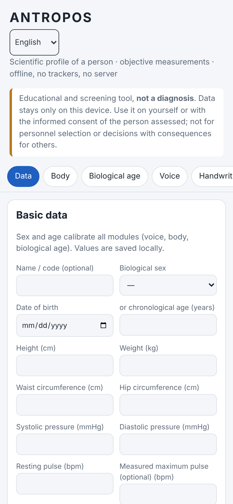

# ANTROPOS

[English](README.md) · [Română](README.ro.md) · [Français](README.fr.md) · [Italiano](README.it.md) · **Español** · [Português](README.pt.md) · [Deutsch](README.de.md) · [Magyar](README.hu.md)

Perfil científico orientativo de una persona, calculado en local: edad biológica (PhenoAge), voz, escritura, test del reloj, personalidad (TIPI) y tiempo de reacción.

**[Abrir la aplicación →](https://antropos.chiuta.ro/)**

_Versión: 1.0.0 · Última actualización: 2026-11-14_

| 1 | 2 | 3 |
|---|---|---|
|  |  |  |

## Capturas de pantalla

       

## Funciones

- Edad biológica PhenoAge, con control de plausibilidad para valores de laboratorio inverosímiles.
- Análisis de voz con filtrado de saltos de octava, grafometría, test del reloj y dibujo de la persona.
- Personalidad TIPI, pruebas de reacción, informe imprimible, exportación/importación JSON y pestaña de metodología.

## Uso

Abre la página en línea, o descarga `index.html` y ábrelo en un navegador reciente. Sin instalación ni build.

## Límites

- Herramienta educativa de cribado, no un diagnóstico; no la uses para decisiones médicas, laborales o legales.
- Úsala contigo mismo o con el consentimiento informado de la persona evaluada.
- Interfaz en 8 idiomas (RO, EN, FR, DE, ES, IT, HU, PT), elegible en el selector de la aplicación; traducciones asistidas por máquina, no revisadas por hablantes nativos.

## Privacidad

Sin seguimiento, sin peticiones de red (CSP `connect-src none`), sin cuentas. Los datos permanecen en este navegador (localStorage) y se pueden borrar en cualquier momento.

## Licencia

MIT — véase [LICENSE](LICENSE).
