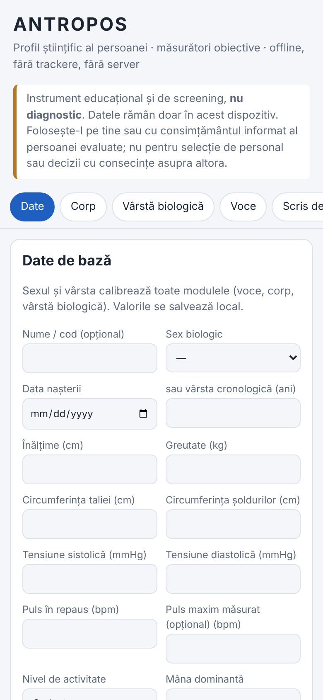
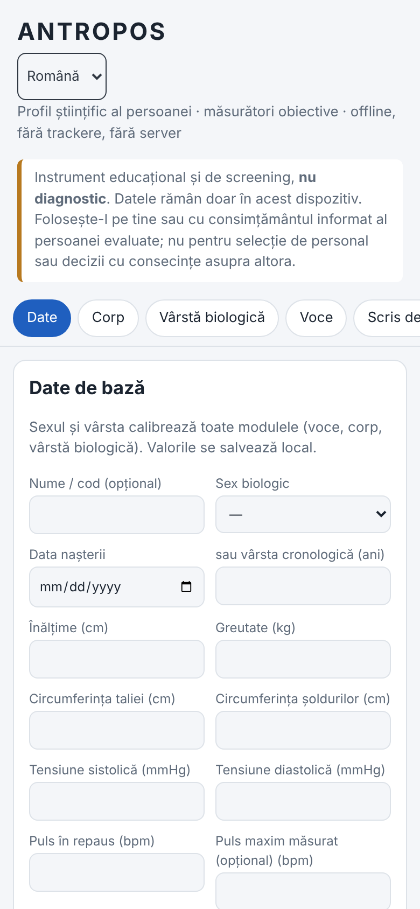
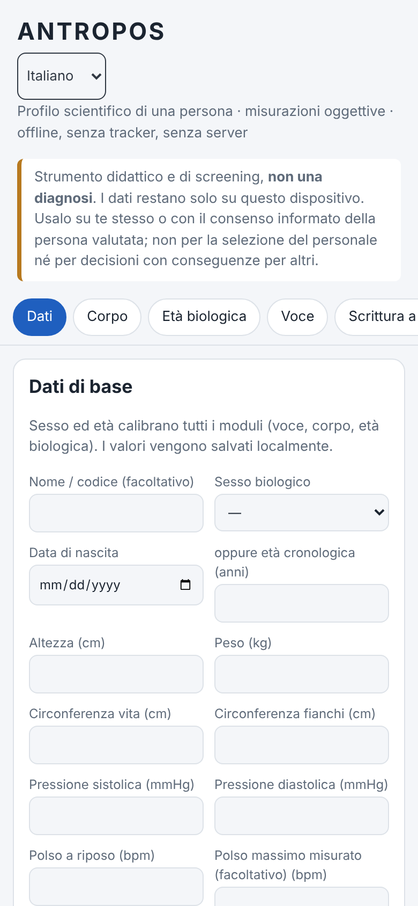

# ANTROPOS

[English](README.md) · [Română](README.ro.md) · **Français** · [Italiano](README.it.md) · [Español](README.es.md) · [Português](README.pt.md) · [Deutsch](README.de.md) · [Magyar](README.hu.md)

Profil scientifique indicatif d’une personne, calculé localement : âge biologique (PhenoAge), voix, écriture, test de l’horloge, personnalité (TIPI) et temps de réaction.

**[Ouvrir l’application →](https://antropos.chiuta.ro/)**

_Version: 1.0.0 · Dernière mise à jour: 2026-11-14_

| 1 | 2 | 3 |
|---|---|---|
|  |  |  |

## Captures d’écran

       

## Fonctions

- Âge biologique PhenoAge, avec garde-fou pour des valeurs de laboratoire invraisemblables.
- Analyse vocale avec filtrage des sauts d’octave, graphométrie, test de l’horloge et dessin de la personne.
- Personnalité TIPI, tests de réaction, rapport imprimable, export/import JSON et onglet méthodologie.

## Utilisation

Ouvrez la page en ligne, ou téléchargez `index.html` et ouvrez-le dans un navigateur récent. Sans installation ni build.

## Limites

- Outil éducatif de dépistage, pas un diagnostic ; ne l’utilisez pas pour des décisions médicales, professionnelles ou juridiques.
- À utiliser sur soi-même ou avec le consentement éclairé de la personne testée.
- Interface en 8 langues (RO, EN, FR, DE, ES, IT, HU, PT), au choix dans le sélecteur de l’application ; traductions assistées par machine, non relues par des locuteurs natifs.

## Confidentialité

Aucun suivi, aucune requête réseau (CSP `connect-src none`), aucun compte. Les données restent dans ce navigateur (localStorage) et peuvent être effacées à tout moment.

## Licence

MIT — voir [LICENSE](LICENSE).
