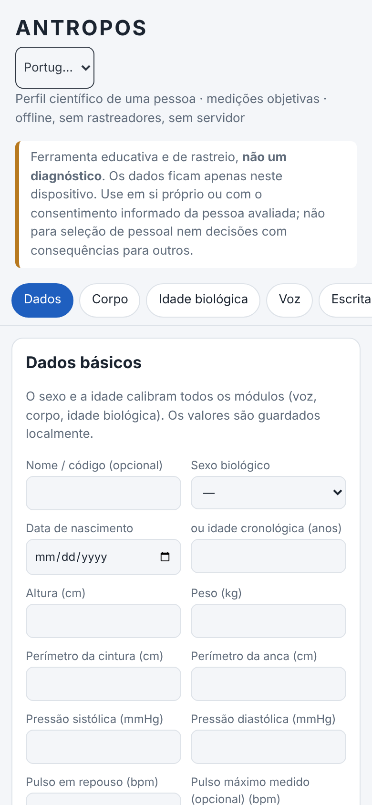

# ANTROPOS

[English](README.md) · [Română](README.ro.md) · [Français](README.fr.md) · **Italiano** · [Español](README.es.md) · [Português](README.pt.md) · [Deutsch](README.de.md) · [Magyar](README.hu.md)

Profilo scientifico orientativo di una persona, calcolato in locale: età biologica (PhenoAge), voce, scrittura, test dell’orologio, personalità (TIPI) e tempo di reazione.

**[Apri l’app →](https://antropos.chiuta.ro/)**

_Versione: 1.0.0 · Ultimo aggiornamento: 2026-11-14_

| 1 | 2 | 3 |
|---|---|---|
|  |  |  |

## Schermate

       

## Funzioni

- Età biologica PhenoAge, con controllo di plausibilità per valori di laboratorio improbabili.
- Analisi della voce con filtro dei salti d’ottava, grafometria, test dell’orologio e disegno della persona.
- Personalità TIPI, test di reazione, report stampabile, esportazione/importazione JSON e scheda metodologia.

## Utilizzo

Apri la pagina online, oppure scarica `index.html` e aprilo in un browser recente. Nessuna installazione né build.

## Limiti

- Strumento didattico di screening, non una diagnosi; non usarlo per decisioni mediche, lavorative o legali.
- Usalo su te stesso o con il consenso informato della persona testata.
- Interfaccia in 8 lingue (RO, EN, FR, DE, ES, IT, HU, PT), selezionabile dal selettore nell’app; traduzioni assistite da macchina, non riviste da madrelingua.

## Privacy

Nessun tracciamento, nessuna richiesta di rete (CSP `connect-src none`), nessun account. I dati restano in questo browser (localStorage) e si possono cancellare in qualsiasi momento.

## Licenza

MIT — vedi [LICENSE](LICENSE).
