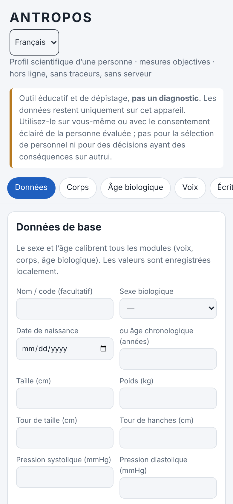

# ANTROPOS

**English** · [Română](README.ro.md) · [Français](README.fr.md) · [Italiano](README.it.md) · [Español](README.es.md) · [Português](README.pt.md) · [Deutsch](README.de.md) · [Magyar](README.hu.md)

Orientative scientific profile of a person, computed locally: biological age (PhenoAge), voice, handwriting, clock drawing, personality (TIPI) and reaction time.

**[Open the app →](https://antropos.chiuta.ro/)**

_Version: 1.0.0 · Last updated: 2026-11-14_

| 1 | 2 | 3 |
|---|---|---|
|  |  |  |

## Screenshots

       

## Features

- PhenoAge biological age with a plausibility guard for implausible lab values.
- Voice analysis with octave-jump filtering, handwriting graphometrics, clock and draw-a-person tests.
- TIPI personality, reaction tests, printable report, JSON export/import and methodology tab.

## Usage

Open the page online, or download `index.html` and open it in a recent browser. No installation, no build.

## Limits

- Educational screening tool, not a diagnosis; do not use it for decisions about health, work or legal matters.
- Use it on yourself or with the informed consent of the person tested.
- Interface in 8 languages (RO, EN, FR, DE, ES, IT, HU, PT), chosen from the selector in the app; translations are machine-assisted and not reviewed by native speakers.

## Privacy

No tracking, no network requests (CSP `connect-src none`), no accounts. Data stays in this browser (localStorage) and can be erased at any time.

## License

MIT — see [LICENSE](LICENSE).
