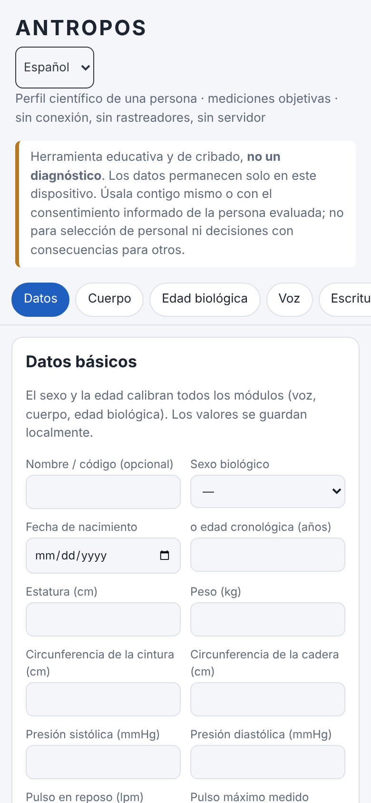

# ANTROPOS

[English](README.md) · [Română](README.ro.md) · [Français](README.fr.md) · [Italiano](README.it.md) · [Español](README.es.md) · **Português** · [Deutsch](README.de.md) · [Magyar](README.hu.md)

Perfil científico orientativo de uma pessoa, calculado localmente: idade biológica (PhenoAge), voz, escrita, teste do relógio, personalidade (TIPI) e tempo de reação.

**[Abrir a aplicação →](https://antropos.chiuta.ro/)**

_Versão: 1.2.1 · Última atualização: 2026-11-15_

| 1 | 2 | 3 |
|---|---|---|
|  |  |  |

## Capturas de ecrã

       

## Funcionalidades

- Idade biológica PhenoAge, com proteção contra valores laboratoriais implausíveis.
- Análise de voz com filtragem de saltos de oitava, grafometria, teste do relógio e desenho da pessoa.
- Personalidade TIPI, testes de reação, relatório imprimível, exportação/importação JSON e separador de metodologia.

## Utilização

Abre a página online, ou descarrega `index.html` e abre-o num navegador recente. Sem instalação nem build.

## Limites

- Ferramenta educativa de rastreio, não é diagnóstico; não a uses para decisões médicas, profissionais ou jurídicas.
- Usa em ti próprio ou com o consentimento informado da pessoa avaliada.
- Interface em 8 idiomas (RO, EN, FR, DE, ES, IT, HU, PT), à escolha no seletor da aplicação; traduções assistidas por máquina, não revisadas por falantes nativos.

## Privacidade

Sem rastreamento, sem pedidos de rede (CSP `connect-src none`), sem contas. Os dados ficam neste navegador (localStorage) e podem ser apagados a qualquer momento.

## Licença

MIT — ver [LICENSE](LICENSE).
