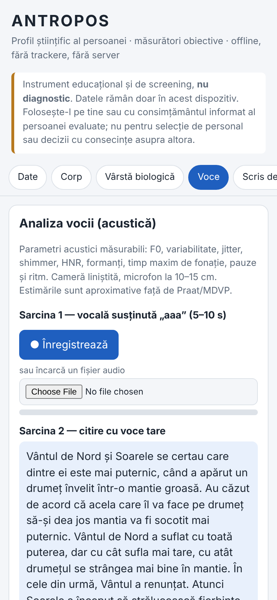
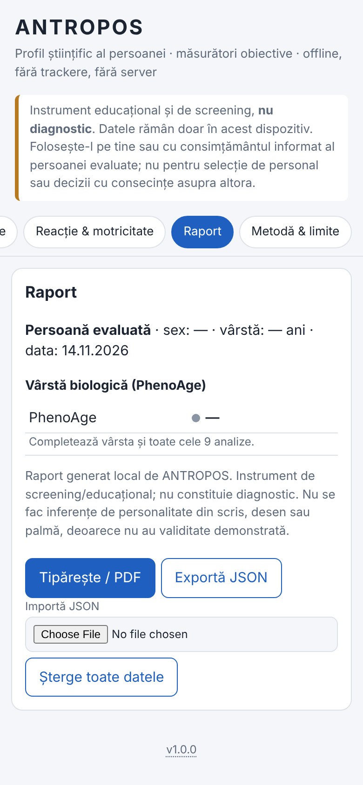

# ANTROPOS

[English](README.md) · **Română** · [Français](README.fr.md) · [Italiano](README.it.md) · [Español](README.es.md) · [Português](README.pt.md) · [Deutsch](README.de.md) · [Magyar](README.hu.md)

Profil științific orientativ al unei persoane, calculat local: vârstă biologică (PhenoAge), voce, scris, desenul ceasului, personalitate (TIPI) și timp de reacție.

**[Deschide aplicația →](https://antropos.chiuta.ro/)**

_Versiune: 1.0.0 · Ultima actualizare: 2026-11-14_

| 1 | 2 | 3 |
|---|---|---|
|  |  |  |

## Funcții

- Vârstă biologică PhenoAge, cu protecție la valori de laborator neplauzibile.
- Analiză vocală cu filtrare a salturilor de octavă, grafometrie, testul ceasului și desenul persoanei.
- Personalitate TIPI, teste de reacție, raport imprimabil, export/import JSON și fila de metodologie.

## Utilizare

Deschide pagina online sau descarcă `index.html` și deschide-l într-un browser recent. Fără instalare, fără build.

## Limite

- Instrument educațional de screening, nu diagnostic; nu îl folosi pentru decizii medicale, de muncă sau juridice.
- Folosește-l pe tine sau cu consimțământul informat al persoanei testate.
- Interfață doar în română deocamdată.

## Confidențialitate

Fără urmărire, fără cereri de rețea (CSP `connect-src none`), fără conturi. Datele rămân în acest browser (localStorage) și pot fi șterse oricând.

## Licență

MIT — vezi [LICENSE](LICENSE).
